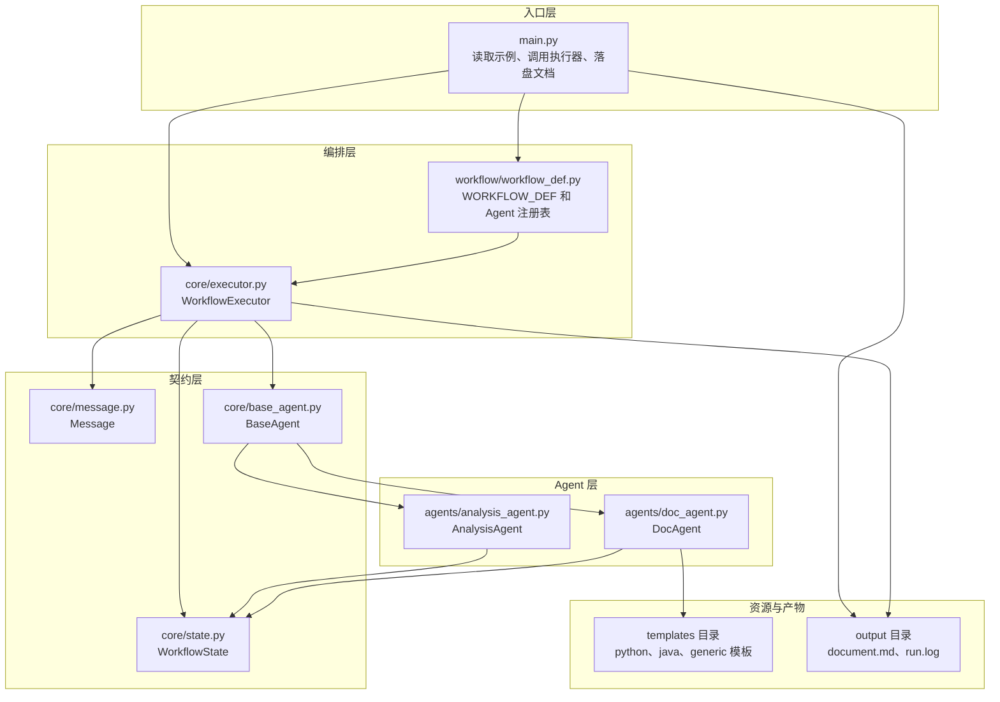
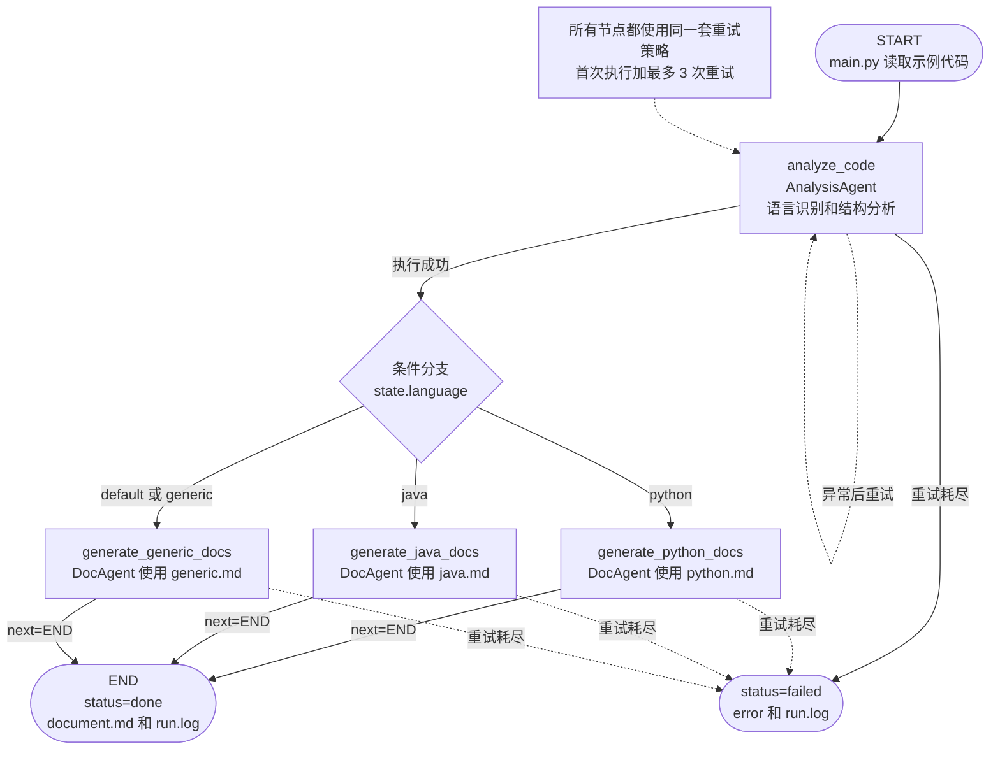
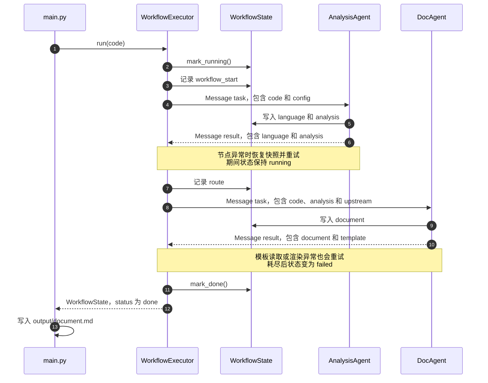
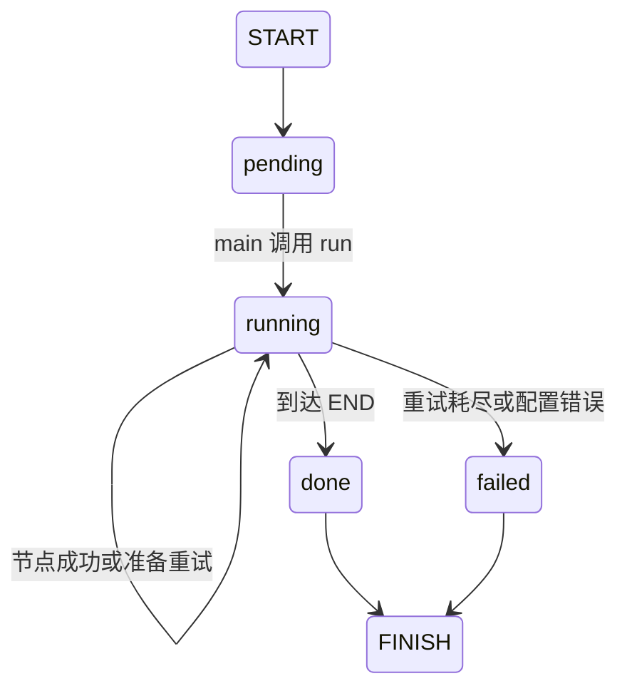
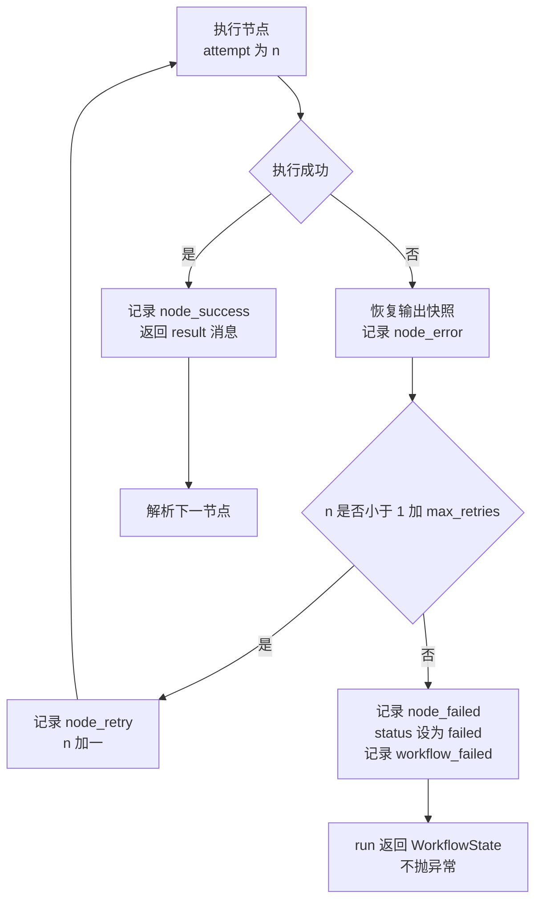

架构设计说明

这个文档说明代码文档生成 Workflow 的整体结构、执行过程、消息传递方式、状态管理和失败处理办法。项目的目标是让 AnalysisAgent 和 DocAgent 通过消息协作，把示例代码转换成一份 Markdown 文档，并让整个流程可以配置、可以重试、可以追踪。

一、设计目标与非目标

项目要能直接用 python main.py 跑通，并且不依赖第三方库。AnalysisAgent 和 DocAgent 之间不能直接调用，必须由执行器传递消息。节点顺序、条件分支和重试次数都放进 WORKFLOW_DEF，执行器只负责通用调度。节点出错时先重试，重试耗尽后把状态改成 failed 并记录错误，不让程序崩溃。共享状态和日志要能说明每一步执行了什么，输入和输出分别是什么。

这个版本不处理并行调度、分布式执行和持久化队列，也不做完整语法树分析。语言识别和结构提取使用正则表达式，够 MVP 演示即可。项目不接入大语言模型或外部服务，不提供 Web 界面，可视化通过 Mermaid 图和生成的 Markdown 文档呈现。

二、分层架构



入口层只处理输入和输出。main.py 读取 examples/sample.py，创建执行器，调用 run，最后把返回状态中的 document 写入 output/document.md。它不判断语言，不调用 Agent，也不处理节点重试。

编排层由流程配置和执行器组成。workflow_def.py 声明有哪些节点、每个节点使用哪个 Agent、下一个节点是谁、什么情况下走分支、失败后重试几次，同时负责把 Agent 实例放进注册表。executor.py 根据这些信息依次执行节点，负责创建消息、处理分支、重试、记录日志和收敛状态。

契约层定义三样东西。Message 规定 Agent 之间传什么，WorkflowState 保存一次运行的共享数据，BaseAgent 规定 Agent 必须实现什么接口。这一层不包含具体业务逻辑。

Agent 层只关心自己的业务。AnalysisAgent 负责分析代码，DocAgent 负责渲染文档。资源层包括三套模板和 output 目录，DocAgent 读取模板，main.py 和执行器写入产物。

三、Workflow 配置

流程写在 workflow/workflow_def.py 的 WORKFLOW_DEF 中。当前配置包含一个分析节点和三个文档节点，三个文档节点共用 DocAgent，只是传入的模板不同。

```python
WORKFLOW_DEF = WorkflowDefinition(
    name="code_to_documentation",
    start="analyze_code",
    max_retries=3,
    max_steps=10,
    nodes={
        "analyze_code": NodeDefinition(
            name="analyze_code",
            agent="analysis_agent",
            next_node="generate_generic_docs",
            branch_on="language",
            branch={
                "python": "generate_python_docs",
                "java": "generate_java_docs",
                "default": "generate_generic_docs",
            },
        ),
        "generate_python_docs": NodeDefinition(
            name="generate_python_docs",
            agent="doc_agent",
            next_node=END,
            config={"template": "python"},
        ),
        "generate_java_docs": NodeDefinition(
            name="generate_java_docs",
            agent="doc_agent",
            next_node=END,
            config={"template": "java"},
        ),
        "generate_generic_docs": NodeDefinition(
            name="generate_generic_docs",
            agent="doc_agent",
            next_node=END,
            config={"template": "generic"},
        ),
    },
)
```

执行器只依赖 WorkflowDefinition、NodeDefinition 和 BaseAgent，不包含 python、java、doc_agent 这些业务名称。branch_on 指定从哪个状态字段取值，branch 提供值和下一节点的对应关系，default 用于兜底。next_node 为 END 表示流程结束。max_steps 用来防止配置成环后无限执行。

max_retries 是节点默认重试次数，表示首次执行之外最多再执行几次。NodeDefinition 也可以单独设置 max_retries，值为负一时表示继承全局配置。

四、主流程



执行器从 START 开始，先执行 analyze_code。成功后读取 state.language，根据配置选择文档节点。文档节点执行完成后到达 END，执行器把状态设为 done，并写入完成日志。任一节点重试耗尽都会进入 failed。

图中只画了 AnalysisAgent 的自环，DocAgent 节点也使用同样的重试逻辑，只是为了避免连线太密没有重复画出来。

五、条件分支

AnalysisAgent 根据代码中的特征为 Python 和 Java 打分。Python 的函数定义、类定义、主入口、导入语句和装饰器会增加 Python 分数，Java 的主方法、类型定义、包导入、标准输出和方法签名会增加 Java 分数。两边都是零分时归为 generic，分数相同时再检查强特征。

执行器完成一个节点后调用 resolve_next 方法。它先看节点有没有 branch，如果有，就读取 branch_on 指定的状态字段，用字段值匹配 branch。匹配不到时使用 default，没有 default 时使用 next_node。没有 branch 的节点直接走 next_node。

三个文档节点都使用同一个 DocAgent 类。DocAgent 优先读取节点配置中的 template，没有配置时再根据 language 选择模板。这样选择哪个模板由流程配置决定，模板怎么渲染由 Agent 负责，两边职责比较清楚。

如果新增一种语言，需要增加三部分内容。第一是 AnalysisAgent 中的识别规则，第二是 templates 目录下的模板文件，第三是 WORKFLOW_DEF 中新的文档节点和分支映射。执行器不需要改动。

六、Message 协议

Message 是 Agent 之间唯一的通信载体。

```python
@dataclass
class Message:
    sender: str
    receiver: str
    msg_type: str
    payload: dict
    trace_id: str
    timestamp: str
    message_id: str
```

sender 和 receiver 表示发送方和接收方，msg_type 在 MVP 中使用 task 和 result，payload 保存任务或结果数据。trace_id 在同一次 Workflow 中保持不变，timestamp 记录创建时间，message_id 用来区分每一条消息。

一条任务消息的示例如下：

```json
{
  "message_id": "5f8a7c9d4e3b2a1f0e9d8c7b6a5f4e3d",
  "trace_id": "workflow_demo_001",
  "sender": "executor",
  "receiver": "analysis_agent",
  "msg_type": "task",
  "timestamp": "20261022T222743+0800",
  "payload": {
    "code": "def add(a, b):\n    return a + b\n",
    "node": "analyze_code",
    "attempt": 1,
    "config": {},
    "language": "unknown",
    "analysis": {},
    "document": ""
  }
}
```

Agent 之间没有直接调用。执行器创建 task 消息，调用 Agent 的 run 方法。Agent 返回 result 消息，执行器先检查它是不是 Message，再检查 trace_id 是否一致。检查通过后，执行器把消息写入 state.messages，把上游结果作为 upstream 放进下一个节点的 payload，同时 Agent 已经把自己的产出写进共享状态。

每条消息都进入 state.messages，所以可以从消息历史看出执行器向哪个 Agent 发了什么任务，Agent 又返回了什么结果。workflow_id 和 trace_id 相同，日志中的 trace 可以直接对应到一次运行。任意一个 Agent 返回非 Message 对象，或者返回消息的 trace_id 不一致，执行器都会把这次尝试当作失败处理。



七、共享状态与状态机

WorkflowState 是一次运行的共享上下文。它保存的字段包括 workflow_id、code、language、analysis、document、status、current_node、logs、error、messages、started_at、finished_at 和 duration_ms。

workflow_id 是本次运行编号，同时作为消息的 trace_id。code 是原始源码，language 是识别结果，analysis 保存类、函数、导入、指标、识别依据和备注。document 是 DocAgent 生成的 Markdown。status 表示流程状态，current_node 表示当前节点。logs 保存结构化日志，error 在成功时为空，失败时保存最终失败原因。messages 保存消息历史，started_at 和 finished_at 记录开始和结束时间，duration_ms 记录耗时。

status 有四种值。刚创建时是 pending，开始执行后是 running，到达 END 后是 done，最终失败后是 failed。run 进入后立即调用 mark_running，所以正常流程不会停留在 pending。current_node 在节点开始执行前更新，成功后由路由切换到下一节点，流程结束时变成 END。失败时 current_node 保留失败节点，方便定位。



每次尝试节点前，执行器会对 language、analysis 和 document 做 JSON 深拷贝快照。如果这次尝试抛出异常，就恢复这三个字段，清除失败尝试留下的半成品。日志和消息历史不恢复，因为它们记录的是真实发生过的过程。这个处理避免了第二次尝试接着使用第一次留下的脏数据。

八、重试与错误处理

全局 max_retries 设为 3。一个节点第一次执行失败后，最多再重试 3 次，所以最多会尝试 4 次。NodeDefinition 也可以单独设置 max_retries，值为负一时表示继承全局配置。

每次尝试都会创建新的 Message，attempt 字段递增，并写入独立的开始日志。成功一次就结束该节点的重试，流程继续。所有尝试都失败后，执行器记录 node_failed 和 workflow_failed，把状态改成 failed，把错误写入 state.error，然后正常返回。



可能进入 failed 的情况包括 Agent 抛异常、Agent 返回的不是 Message、trace_id 不一致、输入为空、配置不合法、路由指向不存在的节点、超过 max_steps，以及文档模板读取或渲染失败。main.py 写文件失败时会捕获 OSError，打印错误并返回非零退出码。

重试没有加入睡眠和退避，因为 MVP 节点执行很快，加退避反而会拖慢课堂演示。这个限制已经写进 README。

九、日志与追踪

日志分两层。第一层是 WorkflowState.logs，保存结构化数据，方便程序读取。第二层是 output/run.log，把同样的信息写成文本，方便课堂展示和排查问题。

每条状态日志有 timestamp、node、agent、event、status、attempt、input_summary、output_summary、duration_ms 和 error 这些字段。输入摘要不会写入完整代码，只写代码字符数、行数和当前语言。输出摘要只写类数量、函数数量、文档长度和模板名，避免日志过大。例如输入摘要会出现 code_chars、lines 和 language，分析节点的输出摘要会出现 classes、functions 和 imports，文档节点的输出摘要会出现 document_chars 和 template。

一次成功运行通常会依次出现：

```text
WORKFLOW_START
NODE_START analyze_code attempt 1
NODE_OK analyze_code
ROUTE analyze_code 到 generate_python_docs
NODE_START generate_python_docs attempt 1
NODE_OK generate_python_docs
ROUTE generate_python_docs 到 END
WORKFLOW_DONE
```

发生重试时会多出 NODE_RETRY，最终失败时会出现 NODE_ERROR 和 WORKFLOW_FAILED。日志中的 status 会随事件变化，例如 running、done、retrying 和 failed。

日志每行都带 trace。由于 workflow_id 和 trace_id 相同，可以把控制台里的流程编号、run.log 中的记录和 state.messages 中的消息对应起来。这样即使流程失败，也能知道是在哪个节点、第几次尝试出的问题。

十、可扩展性设计

新增 Agent 时，写一个继承 BaseAgent 的类，设置唯一的 name，实现 run 方法。下面是一个安全审查 Agent 的示例：

```python
class SecurityAgent(BaseAgent):
    name = "security_agent"

    def run(self, message: Message, state) -> Message:
        findings = scan(message.payload["code"])
        state.analysis["security"] = findings
        return self.make_result(message, {"findings": findings})
```

然后在 build_agent_registry 里注册。

```python
def build_agent_registry(template_dir: str) -> dict:
    return {
        "analysis_agent": AnalysisAgent(),
        "doc_agent": DocAgent(template_dir=template_dir),
        "security_agent": SecurityAgent(),
    }
```

最后在 WORKFLOW_DEF 中增加节点。

```python
"security_review": NodeDefinition(
    name="security_review",
    agent="security_agent",
    next_node="generate_python_docs",
)
```

执行器不需要改动，因为调度逻辑只依赖 BaseAgent 接口。新增 Agent 的代码、注册表和节点配置都在编排层和 Agent 层完成。

修改流程时也不需要改执行器。调整顺序修改 next_node，新增条件值修改 branch，新增文档模板增加 templates 下的文件以及 config.template 和分支，调整重试次数修改 max_retries，修改输入只改 main.py，执行器接口仍然是 run(code)。

模板扩展需要遵守占位符约定。DocAgent 只接受白名单字符组成的模板名，只允许小写字母、数字和下划线，然后拼接 templates 目录下的文件名，并使用文件存在性检查避免路径穿越。模板文件缺失时回退到 generic.md。

模板占位符包括：

```text
{{TITLE}}
{{WORKFLOW_ID}}
{{GENERATED_AT}}
{{LANGUAGE}}
{{LANGUAGE_LABEL}}
{{TEMPLATE_NAME}}
{{SUMMARY}}
{{OVERVIEW}}
{{DETECTION}}
{{CLASSES}}
{{FUNCTIONS}}
{{IMPORTS}}
{{NOTES}}
{{CODE_BLOCK}}
{{METRICS}}
{{DEPENDENCIES}}
```

未知占位符会触发渲染异常，由执行器重试并最终失败，避免生成一半占位符一半内容的文档。

十一、设计决策

消息和共享状态同时存在，看起来有一点重复，但两者用途不同。消息用于说明 Agent 之间传了什么，状态用于把一次运行的上下文集中起来。只保留消息的话，日志和最终结果要反复遍历消息历史；只保留状态的话，又看不出 Agent 之间的任务边界。MVP 选择两者并存，代码稍多，但演示时更清楚。

语言识别使用正则打分，没有引入 AST 或编译器前端。这样做符合零第三方依赖的要求，也方便在课堂上解释识别依据。代价是复杂语法可能识别不完整，因此文档中保留了人工复核的提示。

模板放在独立文件中，不写死在 DocAgent 里。这样新增模板不需要改 Agent 代码，文档格式也可以单独调整。模板使用固定的占位符，未知占位符会触发异常，再交给执行器重试。

流程使用配置数据描述，执行器只负责通用调度。新节点不需要改执行器，代价是配置模型对复杂控制流的表达能力有限，遇到并行或嵌套条件时需要扩展数据结构。

失败处理选择重试、快照恢复和状态收敛。节点失败不会直接中断程序，而是先尽可能恢复，再把最终结果交给调用方。这个选择比较适合课程演示，也方便在日志中观察完整过程。

日志采用状态日志和文件日志并存的方式。状态日志供程序读取，文件日志供课堂展示和排查问题。两份日志有少量重复写入，但用途不同，排查时比较方便。

十二、验证结果

项目在 Python 3.9.12 上完成了端到端验证。Python 示例代码最终状态为 done，识别为 python，生成了 document.md 和 run.log。Java 代码能够命中 Java 分支并使用 Java 模板，无法识别的文本会进入 generic 分支并使用通用模板。

重试做过两类验证。故障 Agent 前两次抛异常、第三次成功时，最终状态为 done，日志中存在 NODE_RETRY。故障 Agent 每次都抛异常时，执行器尝试 4 次后把状态改为 failed，错误写入 state.error 和 run.log，run 方法没有抛出异常。

正常流程中，消息历史有 4 条记录，状态日志有 8 条记录。最终 current_node 为 END，status 为 done，workflow_id 和 trace_id 一致。输出文件存在，文档内容非空，run.log 中包含开始、节点、路由和完成事件。

十三、验收对照

两个 Agent 已经协作完成完整流程，AnalysisAgent 负责分析，DocAgent 负责生成文档。

Agent 间只通过 Message 和执行器通信，没有直接函数调用。

顺序流程已经实现，执行顺序是分析、条件分支、文档生成，最后到达 END。

端到端流程可以运行，最终 status 为 done。

Python、Java 和 Generic 三类条件分支及对应模板都已实现。

节点失败会自动重试，最多 3 次重试，耗尽后状态为 failed。

WorkflowState 记录 current_node、status、logs 和 error。

日志包含时间戳、节点、输入摘要和输出摘要，并落盘到 output/run.log。

WORKFLOW_DEF 实现配置化，BaseAgent 提供统一的 run 方法接口。

DESIGN.md 包含 Mermaid 主流程图、消息时序图、状态机和重试流程图。

项目只使用标准库，python main.py 可以直接运行。

十四、后续可以做的事

后续可以增加有向图环检测和不可达节点提示，给节点加上超时和指数退避，增加最大并发控制，把 WorkflowState 保存成 JSON 以便断点续跑，增加人工审核节点，或者把正则分析替换成可插拔的解析器。

还可以增加命令行参数，让用户选择输入文件、输出目录和模板，或者增加一个简单的 Web 界面查看历史运行记录。这些扩展都不影响当前的 MVP 流程。
